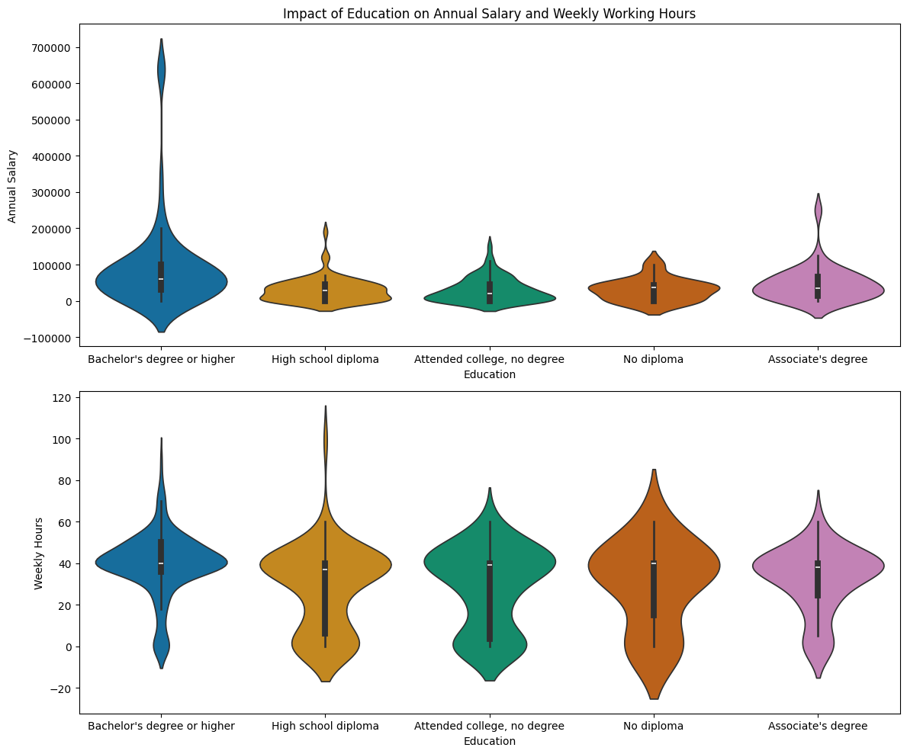

# Data Science Portfolio

Welcome! This portfolio showcases a Python-based exploratory data analysis exercise focusing on **education, annual salary, and weekly working hours**.

## Featured project: Education, Salary, and Working Hours

**Research question:** How do education levels relate to annual salary and weekly working hours in the supplied dataset?

**Tools and methods:** Python, pandas, matplotlib, seaborn, squarify; category proportions, treemaps, and violin plots.

**Dataset:** 500 observations across five education groups. The violin plots use the 385 observations with age below 65. The data source and salary currency were not specified in the exercise.

### Education levels in the dataset

The bachelor's-degree-or-higher group accounts for **47.4%** of the dataset.
**Key Finding:** This treemap illustrates the distribution of respondents across different education levels, allowing readers to compare the relative size of each group.

### Salary and working-hour distributions

Among participants younger than 65, the bachelor's-or-higher group has a median annual salary of **61,000**, compared with **29,000** for the high-school-diploma group. Median weekly hours across education groups range from **37 to 40**.
**Key Finding:** The violin plot compares salary distributions across education levels, highlighting differences in median salaries and the spread of earnings.

### Limitations and next steps

These are descriptive patterns and do not demonstrate causality. The exercise does not document the dataset's source, location, currency, or sampling method. Future work could check representativeness and control for other factors such as age and work experience.

**Project status:** Completed classroom exercise.

**Project code and full README:** [View the project repository](https://github.com/Ruuththlessday/data-science-portfolio.git)
